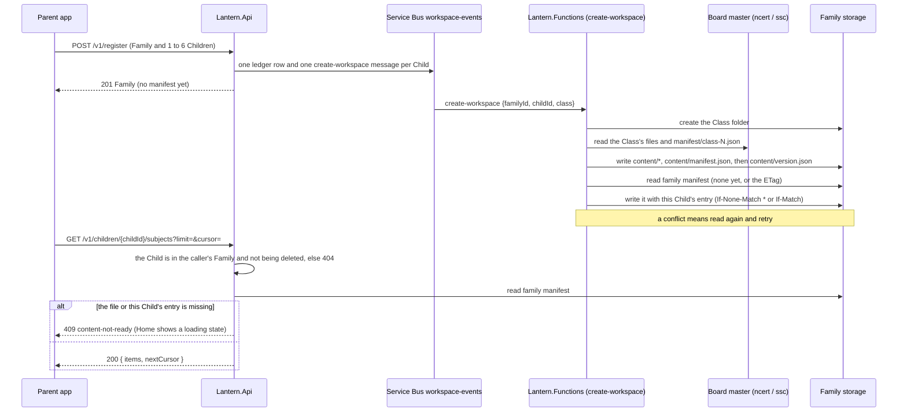

# A Family manifest is a derived index of its Children's Subjects, and Board rules run at build time

The Service Bus queue in the diagram is history: actions are published and subscribed on CloudAMQP ([ADR-0018](0018-actions-are-published-and-subscribed-on-cloudamqp.md)); the Family-level ordering argument below is unchanged.

Home must show a Child's Subjects the moment the Parent opens it, for two Boards whose Books are laid out differently. This ADR records how: the Board's rules run once, when the content is built, and the result is a ready-made list that the API reads from one small file. It builds on ADR-0013 (each Child's Content slice) and changes none of it.

## Why not work it out on every request

Measured on the real UAT masters (`ncert` and `ssc`) and on real slices made by the real copy code for Classes 1, 3, 5, 6 and 10:

- **A Subject is several Books.** NCERT Class 7 Maths has 2, Class 8 Social Science 3, Class 10 Social Science 4 and Class 10 English 3. SSC Environmental Studies is Part 1 plus Part 2. A Subject groups Books and its count is their sum.
- **Built, not declared.** The catalog's `first_chapter` and `last_chapter` are what the publisher lists. NCERT `jewe2` declares 9 Chapters and 7 are built. The count that is true is the number of `summaries/` files (both Boards need one per built Chapter, D89).
- **Names differ by Board and by Class.** NCERT Class 3 calls EVS "The World Around Us"; Classes 4 and 5 hold that and "Environmental Studies" side by side; SSC always says "Environmental Studies".
- **Catalog order is alphabetical by book id**, not an order a Parent would expect.
- **Chapter titles are not in the summary files.** NCERT keeps them only in `refined/*.json` (10 to 26 KB each; Class 10 English is about 25 reads). SSC also has a small `toc/{book}.json` with number and title. SSC's `board.json` already holds build rules (`chapter_unit`, `lessons_nested_in_chapter`, `profile_version`); NCERT has none.

Doing this per request would mean three Blob reads and a listing, plus Board rules written twice in C#, on the screen every Parent opens first.

## Decision

### 1. The Board's rules run once, at build time (in the content build, which lives in the separate `lantern-utilities` repository, ADR-0017)

- **Board profile.** Both Boards get a `board.json` in their master container. SSC keeps its keys and moves to `ssc-v2`; NCERT's is new (`cbse-v1`). Both add an ordered `subjects` list (name and icon; the list order is the display order; a name not listed sorts last, alphabetically, with the icon `book`) and `chapter_titles` (`refined` for NCERT, `toc` for SSC). The build reads it; the API never does.
- **Class manifest.** For each Board and Class the build writes `manifest/class-{N}.json`: the Subjects with their built Chapter counts and Chapters, in the shape the API returns. It is uploaded with the other master files and copied byte for byte into each Child's slice as `content/manifest.json`. A third Board is a profile and a build run.

```json
{
  "schema": "class-manifest-v1",
  "board": "cbse",
  "profileVersion": "cbse-v1",
  "class": 3,
  "subjects": [
    {
      "subjectId": "english", "name": "English", "icon": "english", "chapterCount": 12,
      "chapters": [
        { "chapterId": "cesa101", "bookId": "cesa1", "number": 1, "title": "…", "summary": "…" }
      ]
    }
  ]
}
```

The manifests use camelCase, because their objects reach the app unchanged; `board.json` keeps the snake_case it has.

### 2. The Family manifest

`family/{familyId}/manifest.json` is one file for the whole Family. It is **derived and not authoritative**: each Child's slice stays the source of truth and `content/version.json` stays the record of readiness (ADR-0013). It lists, for each Child whose slice is ready, the Child's Class and Subjects, copied verbatim from the Class manifest, without Chapters.

```json
{
  "schema": "family-manifest-v1",
  "board": "cbse",
  "children": {
    "485c8356-9095-4cb7-a1cd-3228dad1fbb5": {
      "class": 3,
      "profileVersion": "cbse-v1",
      "subjects": [
        { "subjectId": "english", "name": "English", "icon": "english", "chapterCount": 12 }
      ]
    }
  }
}
```

Rules:

- **Only `Lantern.Functions` writes it; the API reads it.** The API never creates it.
- **It is the last step of the `create-workspace` handler** (ADR-0004), after the slice is copied and `version.json` is written: create or update this Child's entry. The remove handler takes the entry out in the same store call that sweeps the Child's Workspace, so one delete is one sweep and one manifest update; a create still copying finds the Child gone when it checks after its copy and cleans up its own files. A Family delete sweeps the Family prefix, and the manifest goes with it. No new action, queue or timer.
- **Entries are added only after readiness**, so an entry means a ready slice. A missing file or a missing entry means "not ready", which the API answers with `409 content-not-ready`.
- **Writes are guarded by the ETag.** Registration queues one `create-workspace` message per Child and the host handles up to four at once, so two Children can finish together. The first write uses `If-None-Match: *`, later ones `If-Match`; on a conflict the handler reads again and retries. An entry that is already present and identical is not rewritten, so a redelivered message changes nothing.
- **It can always be rebuilt.** Re-running each Child's idempotent handler restores a lost or damaged file. The copy of an already-ready slice is a no-op, so only the manifest step does work.
- **A delete racing the create is settled before the write.** The handler checks the Child is still active after the copy and before it adds the entry, so a Child deleted during the copy, the long step, costs a sweep and no manifest I/O. A delete that lands during the one manifest write is cleaned up by its own `remove-workspace` message, which removes the entry in the same store call as the Workspace. In the rare case that the whole remove handler runs inside that single write, a stale entry for a deleted Child can remain; it is never served, because the API finds the Child's row first and answers 404, and deleting the Family sweeps it. A second check after the write would close that gap at the price of a point read on every create, so it is not made.
- **It changes only when a Child is added or removed.** Editing a Child touches the Table row, which is not in the manifest, and a Child's Class is fixed (D88). The one future exception is the `refresh-content` job (ADR-0013, not built), which would also update the refreshed Child's entry.

### Flow: register to Home



## What this does not change

- ADR-0013: a Child's slice, its layout, `version.json` as the readiness marker, pinning, and "no flag on the Child row".
- ADR-0003 and ADR-0002: a Child's delete sweeps that Child's prefix; the manifest entry is removed as part of the same idempotent handler.
- ADR-0004: no new action type.
- D89's NCERT slice rule: an NCERT slice still receives no `board.json`. The file exists in the master as a build input.

## What it amends

D89's per-Board copy rules gain one required file for both Boards: `manifest/class-{N}.json`, copied as `content/manifest.json`. A master with no Class manifest for the Class fails the copy and writes no `version.json`, like any other missing required file.

## Not built here

- Book headings in the Chapters list. A Subject's Chapters are numbered 1 to N across its Books by the API (D115); the manifest keeps `bookId` and the Book's own `number`, so headings can be added later without a rebuild.
- The `refresh-content` job and any back-fill. Slices made before this change have no `content/manifest.json` and no manifest entry; nothing is in production, so those Families are re-registered.
- Merging NCERT's two EVS-type Subjects in Classes 4 and 5. They are shown as the content holds them.

## Considered and rejected

- **Work it out per request in C#:** Board rules written twice, run on every Home open; NCERT titles would need the heavy refined files.
- **A manifest only inside each slice:** the same one-read benefit with no shared file. Rejected by the founder in favour of one index the crew reads, like a flight manifest, without opening each passenger's ticket.
- **The API creates the manifest at register:** a second writer, and an entry before the slice is ready.
- **One action for a whole registration:** one writer, but it reverses D88's "one action per Child", and one Child's failure would retry all of them.
- **Service Bus sessions keyed by Family:** serialise the writers, but a session-enabled queue means a new queue and a change to ADR-0004.
