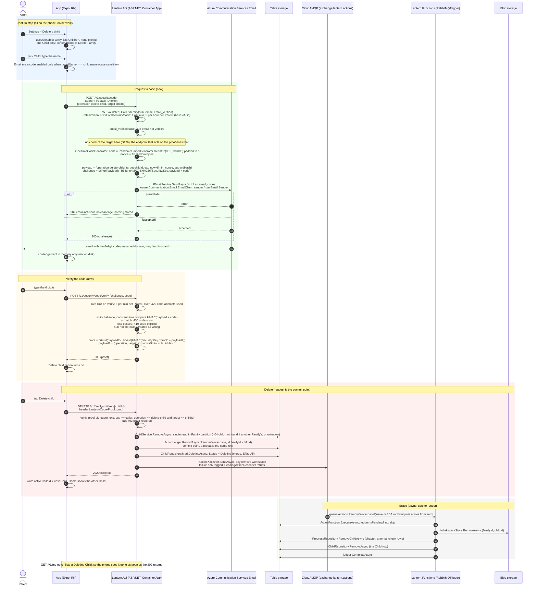
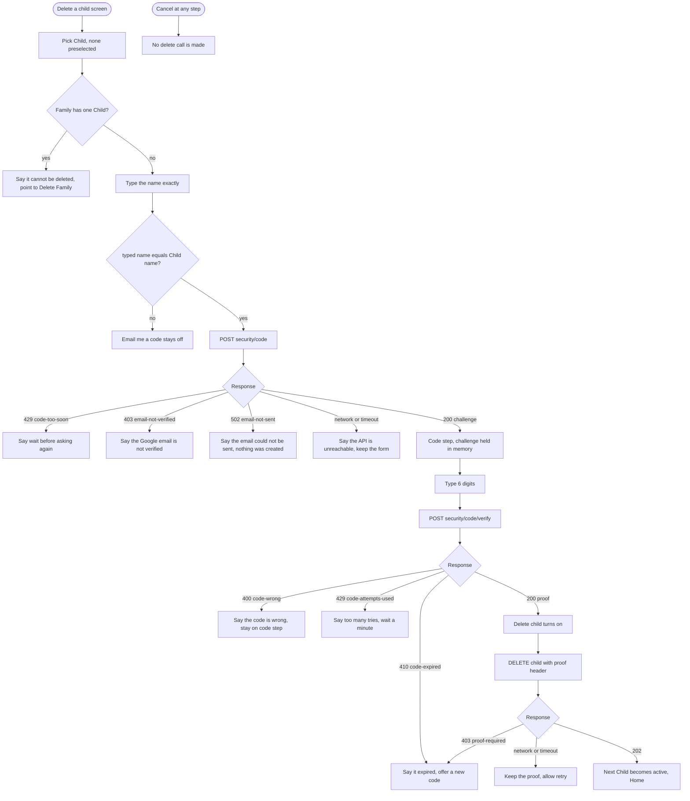

# Delete a Child: end-to-end flow

The flow for #187 under ADR-0019, D125 and D126. The One-time code part is generic: the phone names the operation (`delete-child`) and its target, and `SecurityController` knows neither. Steps marked **new** are built in #187; the rest exists today (ADR-0003, ADR-0018).

## 1. Sequence

## 2. What each failure does on the screen

## 3. Trust and checks, by hop

| Hop | What is checked | Where | Failure |
|---|---|---|---|
| App to API | Firebase ID token signature, issuer, audience | ASP.NET JWT bearer, `[Authorize]` | 401 |
| Request a code | `email_verified`, operation is a kebab name, rate limit. The target is not checked | `OneTimeCodeService`, rate limiter | 403, 400, 429 |
| The challenge | HMAC keyed by `Security:Key` over payload and code. The code is not in it, and the HMAC cannot be tested offline | `ICryptoService.Sign` | none, it is opaque |
| Verify | HMAC match (constant time), expiry, uid hash equals the caller's, 5 a minute | `OneTimeCodeService`, rate limiter | 400, 410, 429 |
| The proof | Separate HMAC key so a challenge is never a proof; operation, target and Parent bound; 5 minutes | `OneTimeCodeService` | 403 |
| Delete | Proof of `delete-child` for this Child and this Parent; the Child belongs to the Family | `ChildService.RemoveAsync` | 403, 404 |
| Erase | The ledger row is still pending; every step repeats safely | `ActionFunction`, `RemoveWorkspaceFunction` | the broker redelivers |

## 4. Stored where

| Thing | Stored | Lifetime |
|---|---|---|
| One-time code | Only in the email | Until the challenge expires (5 minutes) |
| Challenge | Phone memory | The screen's lifetime |
| Proof | Phone memory | 5 minutes, replayable for the same Child (accepted, deleting twice is safe) |
| Ledger row | Table storage `actions` | Until the Function completes it |
| Child row | Table storage `families`, Status `Deleting` then removed | Until the Function removes it |
| Workspace blobs, progress rows | Blob and Table storage | Until the Function removes them |
